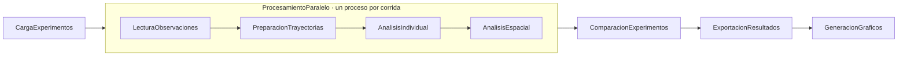

# Análisis de Trayectorias Peatonales

Pipeline en Python que procesa las trayectorias del experimento **BaSiGo – corredor unidireccional**. Hace lo siguiente:

1. Valida las observaciones y reconstruye la trayectoria de cada peatón.
2. Calcula indicadores individuales: distancia, desplazamiento, velocidad, eficiencia y detenciones.
3. Analiza el comportamiento colectivo: zonas, densidad, flujo y diagrama fundamental.
4. Compara las 9 condiciones experimentales.

Laboratorio 1 · Programación Científica.

---

## Requisitos

| Requisito | Detalle |
|---|---|
| Sistema operativo | Linux y Windows |
| Python | **3.10 o superior**. Verificar con `python3 --version`. |
| Bibliotecas | Solo la biblioteca estándar. **matplotlib** es opcional: sin ella se generan todos los resultados, excepto las figuras. |

> **Python 3.10+ es obligatorio.** o el programa fallará

---

## Instalación en Linux

```bash
# 1. Clonar el repositorio (incluye los datos en data/)
git clone https://github.com/whoskanito/Taller1PrograCientifica.git
cd Taller1PrograCientifica

# 2. Crear y activar un entorno virtual
python3 -m venv .venv | `sudo apt install python3-venv` (Debian/Ubuntu)
source .venv/bin/activate

# 3. Instalar las dependencias (solo matplotlib, para las figuras)
pip install -r requirements.txt
```

---

## Ejecución

Con el entorno activado, desde la carpeta del proyecto:

```bash
python3 main.py
```

- Lee los archivos de `data/` y deja todos los resultados en `results/`.
- Al terminar, el programa sale con código **0** si todo funcionó y con **1** si hubo un error. El error se muestra en pantalla.

Cada vez que se abra una terminal nueva hay que volver a activar el entorno:

```bash
cd Taller1PrograCientifica
source .venv/bin/activate
python3 main.py
```

Para ver todas las opciones disponibles:

```bash
python3 main.py --help
```

### Opciones de línea de comandos

Todas son opcionales. Solo se escriben las que se quieren cambiar; las demás usan su valor por defecto.

| Opción | Por defecto | Descripción |
|---|---|---|
| **Entrada y salida** | | |
| `--input RUTA` | `./data` | Directorio con los `.txt` de trayectorias, o un único archivo |
| `--output RUTA` | `./results` | Directorio donde se escriben los resultados |
| `--fps N` | (de la cabecera) | Frecuencia de muestreo. Solo se usa si un archivo no indica `# framerate` en su cabecera. |
| **Validación** | | |
| `--vel-max V` | `4.0` | Velocidad [m/s] sobre la cual un salto entre frames se descarta como error de tracking |
| `--duracion-min T` | `1.0` | Duración mínima [s] para conservar una trayectoria |
| **Análisis individual** | | |
| `--ventana T` | `1.0` | Ancho [s] de la ventana de suavizado de la velocidad |
| `--umbral-detencion V` | `0.2` | Velocidad [m/s] bajo la cual un peatón se considera detenido |
| `--duracion-detencion T` | `0.5` | Duración mínima [s] de una detención |
| **Análisis espacial** | | |
| `--ancho-zona L` | `1.0` | Largo [m] de cada zona del corredor |
| `--linea-flujo X` | `0.0` | Coordenada x [m] de la línea transversal donde se mide el flujo |
| `--ventana-flujo T` | `10.0` | Duración [s] de los intervalos de la serie de flujo |
| **Ejecución** | | |
| `--procesos N` | mitad de los núcleos | Procesos para analizar los experimentos en paralelo; `1` = secuencial |
| `--sin-graficos` | — | No genera las figuras |


> ⚠️ **Cada ejecución borra y vuelve a crear el directorio de salida**, para que nunca se mezclen resultados de ejecuciones distintas. Para probar otra configuración sin reemplazar `results/`, indique otro `--output`.
>
> Por seguridad, el programa **solo borra un directorio vacío o uno creado por él mismo**, identificado por el archivo `.resultados_pipeline`. Si `--output` apunta a otra carpeta con contenido, se detiene sin borrar nada.

Los parámetros usados en cada ejecución quedan registrados en `resumen.json` (sección `"parametros"`), para poder reproducirla.

---

## Resultados generados

```
results/
├── experimentos.csv            # una fila por corrida: resumen para comparar condiciones
├── individuales.csv            # una fila por peatón: indicadores individuales
├── zonas.csv                   # una fila por zona y corrida: peatones, velocidad, tiempo de cruce, densidad
├── densidad.csv                # serie por segundo: densidad y velocidad en el área de medición
├── flujo.csv                   # serie por intervalo: cruces de la línea y flujo
├── diagrama_fundamental.csv    # velocidad y flujo por rango de densidad, con el modelo de Weidmann
├── validacion.csv              # registros descartados en la validación, por corrida
├── resumen.json                # parámetros de la ejecución, indicadores globales y metadata
└── figuras/
    ├── trayectorias.png
    ├── densidad_tiempo.png
    ├── flujo_tiempo.png
    ├── diagrama_fundamental.png
    ├── zonas.png
    ├── comparacion_experimentos.png
    └── distribuciones_individuales.png
```

- Los CSV usan coma como separador y codificación UTF-8, con valores redondeados a 4 decimales.
- Todos los CSV con datos por corrida incluyen la columna `experimento`.
- Un valor no definido (por ejemplo, la velocidad en un segundo sin peatones) aparece como celda vacía en los CSV y como `null` en el JSON.

Unidades: posiciones y distancias en **m**, tiempos en **s**, velocidades en **m/s**, densidad en **personas/m²**, flujo en **personas/s** y flujo específico en **personas/(m·s)**.

---

## Datos

Los datos están en `data/` y provienen del experimento *Pedestrian flow in a unidirectional corridor* (proyecto BaSiGo, Forschungszentrum Jülich, 2013), DOI [10.34735/ped.2013.6](https://doi.org/10.34735/ped.2013.6).

- `uni_corr_500_01.txt` … `uni_corr_500_09.txt`: una corrida por archivo, en un corredor de 18 m × 5 m.
  - Las corridas 01–04 estrechan la **entrada** (1–4 m).
  - La corrida 05 no tiene estrechamiento.
  - Las corridas 06–09 estrechan la **salida** (4–1 m).
- Formato de cada línea: `id frame x y z`, con coordenadas en metros.
  - Las líneas que empiezan con `#` son la cabecera, que incluye el `framerate`.
  - **La corrida 02 está registrada a 25 fps y las demás a 16 fps.** El programa lee la frecuencia de cada archivo.
- `metadata.json`: geometría y parámetros de cada corrida (anchos, sentido de movimiento y notas).

---

## Estructura del proyecto

```
.
├── main.py                     # punto de entrada: opciones de línea de comandos y armado del pipeline
├── requirements.txt
├── data/                       # trayectorias (.txt) y metadata.json
├── pipeline/                   # infraestructura genérica, independiente del problema
│   ├── contexto.py             #   ContextoPipeline: rutas y parámetros de la ejecución
│   ├── etapa.py                #   EtapaPipeline y EtapaPorElemento: interfaces de las etapas
│   ├── paralelo.py             #   ProcesamientoParalelo: reparte etapas por elemento entre procesos
│   └── pipeline.py             #   Pipeline: ejecuta las etapas en secuencia
├── models/                     # entidades del dominio
│   ├── observacion.py          #   posición de un peatón en un frame (inmutable)
│   ├── trayectoria.py          #   observaciones de un peatón y sus cálculos (distancia, velocidad, …)
│   ├── experimento.py          #   una corrida: datos, condición experimental y resultados
│   ├── region.py               #   rectángulo del corredor (zonas y área de medición)
│   └── resultado_analisis.py   #   resultados comparativos de todas las corridas
└── stages/                     # etapas del pipeline
    ├── carga.py                #   1. búsqueda de archivos y lectura de observaciones
    ├── preparacion.py          #   2–4. validación, organización y reconstrucción de trayectorias
    ├── individual.py           #   5. indicadores individuales y detenciones
    ├── espacial.py             #   6. zonas, densidad y flujo
    ├── colectivo.py            #   6. comparación de experimentos y diagrama fundamental
    ├── exportacion.py          #   7. escritura de CSV y JSON
    └── graficos.py             #   7. figuras (matplotlib)
```

### Flujo del pipeline



- **Etapas por corrida:** cada corrida es independiente hasta el análisis espacial, por eso esas etapas se ejecutan en paralelo, con un proceso por corrida (`--procesos`).
- **Etapas finales:** la comparación, la exportación y las figuras combinan todas las corridas.

Algunos parámetros del análisis espacial son constantes del código y no opciones de línea de comandos:
- región analizada x ∈ [-5, 4] m, que es el tramo cubierto por las cámaras en todas las corridas;
- área de medición x ∈ [-2, 2] m (20 m²).

Están en `stages/espacial.py`.

---

## Ejecución en Windows (VS Code)

En la terminal integrada (PowerShell):

```powershell
python -m venv .venv
.venv\Scripts\Activate.ps1
pip install -r requirements.txt
python main.py
```

- El botón ▶ de VS Code ejecuta sin opciones (todo por defecto). Para usar opciones, ejecutar desde la terminal.
